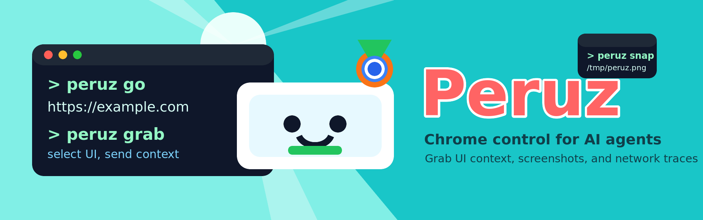
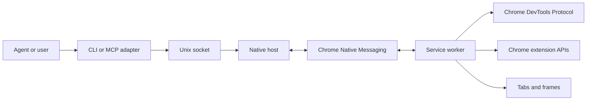

<p>
  
</p>

# Peruz

Local browser automation for AI agents, terminal users, and scripts.

[](https://www.npmjs.com/package/peruz-cli)
[](https://github.com/danishaft/peruz-cli/actions/workflows/ci.yml)
[](LICENSE)
[](package.json)

Peruz connects a command-line client to a Chromium extension through Chrome
Native Messaging. It exposes browser navigation, semantic page reading,
interaction, screenshots, network inspection, device emulation, workflows, and
an optional MCP interface without sending browser control through a hosted
service.

```bash
peruz go "https://example.com"
peruz read
peruz click e5
peruz snap
```

## Requirements

- Node.js 22 or newer
- macOS with Chrome, Chromium, Brave, Edge, or Arc; or
- Linux with Chrome, Chromium, Brave, or Edge
- ImageMagick on Linux for screenshot resizing

Linux builds and automated checks pass, but the browser compatibility matrix is
still open. Windows is not supported.

## Install

Install the package:

```bash
npm install --global peruz-cli
```

Load the extension:

1. Run `peruz extension-path`.
2. Open `chrome://extensions`.
3. Enable developer mode and choose **Load unpacked**.
4. Select the path printed by the command.
5. Copy the extension ID shown by Chrome.

Register the native host, restart the browser, and verify the connection:

```bash
peruz install <extension-id>
peruz tab.list
```

Choose another Chromium browser explicitly:

```bash
peruz install <extension-id> --browser brave
peruz install <extension-id> --browser all
```

Remove Peruz-owned native messaging files with:

```bash
peruz uninstall
peruz uninstall --all
```

## Use

The built-in help is the command reference:

```bash
peruz --help
peruz --help-full
peruz --help-topic frames
peruz click --help
peruz --find network
```

### Read and interact

`page.read` returns an accessibility tree with stable element references for the
current snapshot. Semantic locators can act without a reference.

```bash
peruz read --depth 3 --compact
peruz locate.role button --name "Submit" --action click
peruz locate.label "Email" --action fill --value "user@example.com"
peruz click e5
peruz type "hello" --submit
peruz key Escape
```

### Tabs, windows, and frames

```bash
peruz tab.list
peruz tab.new "https://example.com"
peruz tab.switch 123
peruz window.new "https://example.com"
peruz frame.list
peruz frame.switch --index 0
peruz frame.main
```

Use `--window-id <id>` when an agent should remain inside an isolated browser
window.

### Screenshots and inspection

```bash
peruz screenshot --output /tmp/page.png
peruz screenshot --fullpage --annotate
peruz element.styles e5
peruz page.layout --depth 4
peruz console
```

Screenshots are resized to a maximum dimension of 1200 pixels unless `--full`
is set.

### Grab page elements

Use Grab when you need implementation context for one visible element:

```bash
peruz grab
peruz grab --format json
peruz grab --verbose
```

The extension also displays a **Grab** control on supported pages. Drag the
control to any viewport position, or select it to start the picker. A completed
drag does not start a capture. Peruz keeps the control inside the viewport when
you drag it or resize the window.

### Network and performance

```bash
peruz network --exclude-static
peruz network --method POST --type json
peruz network.body <request-id>
peruz network.curl <request-id>
peruz perf.metrics
peruz perf.start
peruz perf.stop
```

Network capture is active while the extension is connected. Response bodies are
bounded and fetched on demand.

### Emulation and waits

```bash
peruz emulate.device "iPhone 14"
peruz emulate.viewport --width 375 --height 812
peruz emulate.device reset
peruz wait.element ".loaded"
peruz wait.network
peruz wait.url "/dashboard"
```

### Workflows

Run several actions as one workflow:

```bash
peruz do 'go "https://example.com" | wait.network | read'
peruz --script workflow.json --dry-run
```

Use `peruz workflow.validate`, `peruz workflow.list`, and
`peruz workflow.info` to inspect stored workflows.

### Browser-backed AI

Peruz includes clients for ChatGPT, Gemini, Perplexity, and Grok pages. They use
the browser session already signed in to those services:

```bash
peruz chatgpt "summarize this page" --with-page
peruz gemini "explain this chart" --with-page
peruz perplexity "research this topic"
peruz grok "summarize recent discussion"
```

These clients depend on third-party page structure and can break when those
sites change. Review the target service's terms and avoid exposing sensitive
page content.

## Interfaces

The CLI is the primary interface. The same native host also exposes a local
Unix-socket protocol and a subset of commands over MCP.

Start the stdio MCP server:

```bash
peruz mcp
```

Send a direct socket request:

```bash
SOCKET_PATH=$(node -p "require('./native/runtime-paths.cjs').SOCKET_PATH")
printf '%s\n' \
  '{"type":"tool_request","method":"execute_tool","params":{"tool":"tab.list","args":{}},"id":"1"}' \
  | nc -U "$SOCKET_PATH"
```

Peruz stores the socket and generated artifacts in an owner-only runtime
directory. It uses `$PERUZ_RUNTIME_DIR` when set, then
`$XDG_RUNTIME_DIR/peruz`, and otherwise `/tmp/peruz-<uid>`. The Unix socket and
runtime files use mode `0600`; the directory uses mode `0700`. MCP and CLI
requests still carry the same browser privileges as the installed extension.

## Architecture



The CLI parses commands and formats output. The host owns request correlation,
timeouts, socket access, and the Native Messaging stream. The extension owns
browser state, CDP attachment, page snapshots, and Chrome API fallbacks.

See [system.md](system.md) for protocols, sequences, security boundaries, and
failure behavior.

## Security

Peruz can read page content, cookies, requests, and browser state, and can
execute JavaScript in permitted pages. Treat it as a privileged local tool:

- load the extension only from a trusted checkout or package;
- do not expose the local Peruz socket through a network proxy;
- inspect scripts before running `peruz --script`;
- keep agent-controlled browser profiles separate from personal browsing when
  practical;
- never commit captured cookies, headers, or response bodies.

Chrome blocks automation on protected pages such as `chrome://` URLs and the
Chrome Web Store.

## Development

```bash
git clone https://github.com/danishaft/peruz-cli.git
cd peruz-cli
npm install
npm run lint
npm run check
npm run check:cli
npm test
npm run build
```

Load `dist/` as the unpacked extension. After native-host changes, rerun
`peruz install <extension-id>` from the checkout and restart the browser.

The test suite covers pure browser logic and protocol helpers. It does not
replace the open end-to-end browser matrix listed in
[`agent/todo.md`](agent/todo.md).

## License

[MIT](LICENSE)
