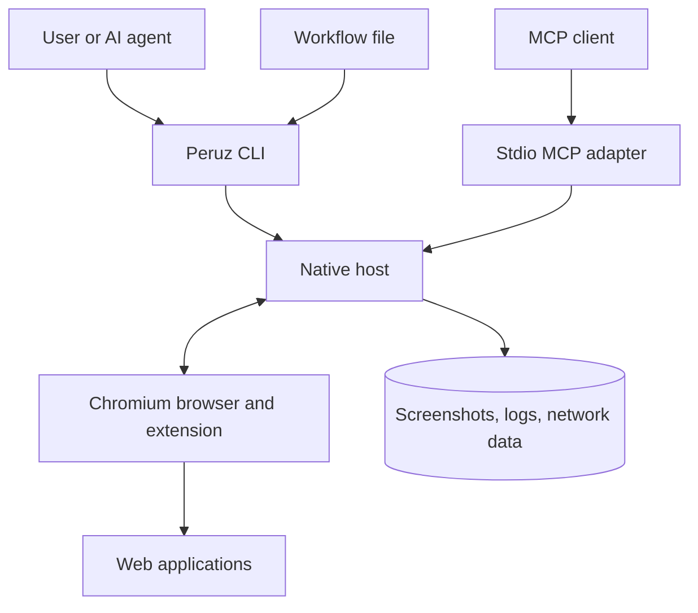
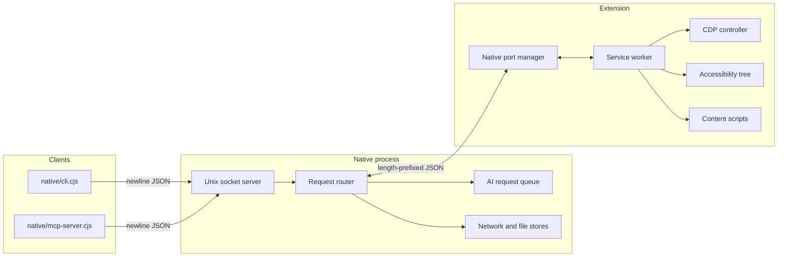
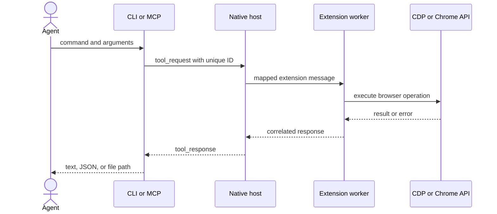
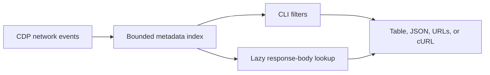

# System design

Peruz separates terminal-facing interfaces from browser execution. The native
host is the local trust boundary between Unix clients and a Chromium extension.

## System context

No hosted Peruz service is involved. Browser-backed AI commands communicate
with third-party websites through the signed-in browser profile.

## Runtime components

The socket protocol makes CLI and MCP behavior share one execution path. Chrome
Native Messaging frames communication between the host process and extension.
The extension chooses CDP or a Chrome extension API according to the operation
and page restrictions.

## Command execution

The CLI applies a 30-second default timeout. Browser-backed AI and capture
commands use longer bounded timeouts. Errors remain errors unless the caller
explicitly selects `--soft-fail`.

## Page model

`page.read` builds an accessibility-oriented snapshot and assigns element
references such as `e5`. References belong to the current page state; they are
not durable database identifiers. Semantic locators query role, text, or label
at execution time.

Frame selection changes the active execution context. Window and tab IDs can be
passed explicitly, which lets an agent operate in an isolated browser window
without silently changing the user's active target.

## Network capture

Static assets and large bodies are handled separately to prevent routine
capture from growing without limit. Network output can contain credentials or
personal data and must be treated as sensitive.

## Browser-backed AI

ChatGPT, Gemini, Perplexity, and Grok adapters serialize expensive requests
through a native-host queue. They open or reuse target tabs, drive the current
web UI, and collect visible output.

These adapters are not stable APIs. A site redesign, authentication challenge,
account restriction, or changed model name can cause an explicit failure. The
system does not claim that a page fallback is equivalent to a provider API.

## Security boundaries

The native host creates `/tmp/surf.sock` with mode `0600`, limiting access to
the current Unix user. Native Messaging also requires the installed extension
ID in the browser manifest.

The extension remains highly privileged within browser-granted permissions. The
socket boundary prevents other operating-system users from connecting, but it
does not protect a user from an untrusted local process running under the same
account.

Files written to `/tmp` can include screenshots, logs, and network records.
Users should isolate automation profiles and avoid retaining sensitive output.

## Installation model

`peruz install` writes a browser-specific Native Messaging manifest and wrapper
owned by Peruz. `peruz uninstall` removes those owned files. Extension loading
is manual because Chromium requires explicit user approval for unpacked
extensions.

The installation path differs by operating system and browser. That is why
browser and operating-system compatibility remains an end-to-end verification
task rather than a unit-test claim.

## Failure behavior

- A missing socket means the extension or native host is not connected.
- A disconnected extension fails pending work rather than returning success.
- Unknown commands and invalid target identifiers fail before browser action.
- Restricted browser pages return explicit limitations.
- Request timeouts close the client socket and exit non-zero.
- `--soft-fail` is opt-in for workflows that intentionally tolerate a failed
  action.

## Design decisions

- Keep one execution path behind CLI, socket, and MCP adapters.
- Use accessibility data for agent-readable state and CDP for low-level control.
- Fall back to Chrome APIs only where their semantics are understood.
- Keep the system local and avoid accounts, cloud relays, and remote control.
- Delay a Windows implementation until path, socket, and browser-host behavior
  can be tested on Windows.

## Verification boundary

The repository verifies source lint, TypeScript contracts, CLI syntax, unit
behavior, and production builds on Node.js 22 and 24. Those checks do not prove
browser installation or every command against every browser version. The open
compatibility work is tracked in `agent/todo.md`.
